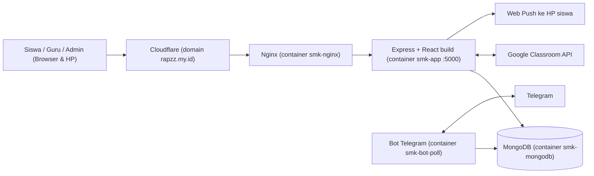

# Panduan Dokumentasi & Presentasi
## Sistem Informasi Akademik SMK TKJ — `https://rapzz.my.id`

> Dokumen ini punya 2 bagian:
> - **Bagian A** — Ringkasan proses pembuatan project kalau dikerjakan **secara manual**, dari nol sampai online.
> - **Bagian B** — Panduan **cara mengambil screenshot** tiap tahap untuk bahan presentasi/laporan.

---

# BAGIAN A — RINGKASAN PROSES PEMBUATAN (MANUAL)

## A1. Gambaran Singkat Project

Website akademik untuk jurusan TKJ yang menggabungkan **data nilai Google Classroom + nilai manual guru**, lalu menampilkannya ke siswa dalam bentuk dashboard, peringkat, daftar tugas, dan tagihan tugas. Notifikasi dikirim lewat **Telegram** dan **Web Push**.

| Pengguna | Yang bisa dilakukan |
|---|---|
| **Siswa** | Beranda, Nilai Saya, Peringkat, Kotak Pesan, Tugas, Tagihan Tugas, Profil & Akun |
| **Guru** | Ringkasan, Input Nilai, Nilai Classroom (+ Export Excel), Buat Tugas, Google Classroom |
| **Admin** | Semua menu guru + Data Siswa, Kalender Tugas, Pesan, Kode Aktivasi, Import Data, Akun Guru, Backup, Monitoring |

### Teknologi

| Lapisan | Teknologi |
|---|---|
| Frontend | React 18, Vite 5, Tailwind CSS, React Router, Axios, xlsx-js-style |
| Backend | Node.js 20, Express 4, Mongoose 8, JWT, bcryptjs, zod, winston, node-cron, compression |
| Database | MongoDB 7 |
| Integrasi | Google Classroom API (OAuth2), Telegram Bot API, Web Push (VAPID) |
| Infrastruktur | Docker + Docker Compose, Nginx, VM Linux (Amazon Linux), Cloudflare (DNS/HTTPS), Tailscale (akses SSH) |

### Arsitektur



---

## A2. Urutan Tahapan (Timeline)

| Fase | Kegiatan | Hasil Akhir | File / Folder Utama |
|---|---|---|---|
| 0 | Analisis kebutuhan & desain | Daftar fitur, rancangan database, wireframe | `docs-ui/` |
| 1 | Menyiapkan lingkungan kerja | Node.js, MongoDB, VS Code, Git siap | — |
| 2 | Membuat struktur project | Folder `backend/` & `frontend/` | root project |
| 3 | Backend dasar & database | Server Express tersambung ke MongoDB | `server.js`, `config/db.js`, `models/` |
| 4 | Autentikasi & hak akses | Login JWT, role siswa/guru/admin | `routes/auth.js`, `middleware/auth.js` |
| 5 | Data siswa & seed | 215 siswa + akun login masuk database | `seed-real-students.js`, `data-siswa-*.csv` |
| 6 | Fitur akademik (API) | Dashboard, nilai, ranking, tugas, tagihan | `routes/dashboard.js`, `analytics.js`, `grades.js` |
| 7 | Integrasi Google Classroom | Sinkron tugas & nilai, buat tugas dari web | `services/classroom.js`, `routes/classroomRealtime.js` |
| 8 | Bot Telegram & Web Push | Aktivasi, OTP, notifikasi tugas | `bot-poll.js`, `services/telegram*.js`, `webpush.js` |
| 9 | Frontend | Portal Siswa & Portal Staff | `frontend/src/` |
| 10 | Fitur admin lanjutan | Import, export Excel, backup, monitoring | `routes/admin.js`, `tools.js`, `services/backup.js` |
| 11 | Pengujian lokal | Semua fitur dicoba di `localhost` | — |
| 12 | Containerisasi (Docker) | Image aplikasi + compose | `Dockerfile`, `docker-compose*.yml` |
| 13 | Deploy ke VM + domain | Online di `https://rapzz.my.id` | `nginx/vm-conf/`, `MIGRASI-VM.md` |
| 14 | Optimasi & pemeliharaan | Lebih cepat, backup otomatis, update rutin | `vite.config.js`, indeks MongoDB |

---

## A3. Detail Singkat Tiap Fase

### Fase 0 — Analisis Kebutuhan
1. Mengumpulkan masalah: nilai Classroom tersebar, siswa sering lupa tugas, guru repot rekap nilai.
2. Menentukan fitur dan peran pengguna (siswa, guru, admin).
3. Merancang koleksi database: `User`, `Student`, `Grade`, `CourseworkCache`, `AdminMessage`, `ActivationCode`, `ChatId`, `PushSubscription`.
4. Membuat sketsa tampilan (wireframe) untuk halaman Login, Portal Siswa, dan Portal Staff.

### Fase 1 — Lingkungan Kerja
```bash
node -v        # Node.js 20
npm -v
mongod --version   # atau pakai MongoDB lewat Docker
git --version
```
Akun yang disiapkan: **Google Cloud Console** (aktifkan Classroom API + OAuth Client), **@BotFather** (token bot Telegram).

### Fase 2 — Struktur Project
```bash
mkdir classroom-update && cd classroom-update
mkdir backend frontend nginx
cd backend && npm init -y
mkdir config models routes services middleware utils seeds
```

### Fase 3 — Backend Dasar & Database
```bash
npm install express mongoose dotenv cors express-rate-limit winston node-cron compression
npm install -D nodemon
```
- `config/db.js` → koneksi MongoDB.
- `server.js` → Express, CORS, kompresi, rate limit, pendaftaran route, `GET /api/health`.
- `models/*.js` → schema + indeks database.
- `.env` → `MONGODB_URI`, `JWT_SECRET`, `PORT`, dll. (`.env.example` sebagai contoh yang aman dibagikan).

### Fase 4 — Autentikasi
```bash
npm install jsonwebtoken bcryptjs zod
```
- Password di-hash dengan bcrypt sebelum disimpan.
- `POST /api/auth/login` mengembalikan token JWT.
- `middleware/auth.js` → `auth`, `adminOnly`, `staffOnly`.
- Lupa password → OTP dikirim ke Telegram.

### Fase 5 — Data Siswa
- Data siswa per kelas disiapkan dalam CSV (`data-siswa-X-TKJ1.csv`, dst).
- Script seed membuat dokumen `Student` + akun `User` untuk tiap siswa, serta akun admin (`create-admin.js`).
```bash
node seed-real-students.js
node create-admin.js
```

### Fase 6 — Fitur Akademik (API)
| Endpoint | Fungsi |
|---|---|
| `GET /api/dashboard` | Nilai per mapel, rata-rata, peringkat kelas & angkatan, pesan, kontak admin |
| `GET /api/dashboard/missing-tasks` | Tugas yang belum dikumpulkan |
| `GET /api/analytics/tasks` | Daftar tugas & tagihan (rentang tanggal) |
| `/api/grades` | Input nilai manual guru |
| `/api/classroom-grades` | Rekap nilai Classroom per kelas |

### Fase 7 — Integrasi Google Classroom
```bash
npm install googleapis
```
1. OAuth: guru klik "Hubungkan Google" → izin → token disimpan.
2. Sinkronisasi course → coursework → submission ke `CourseworkCache`.
3. Pencocokan siswa Classroom dengan data siswa sekolah.
4. Membuat tugas baru dari web langsung ke Google Classroom.
5. Cron sinkron otomatis tiap pagi.

### Fase 8 — Telegram & Web Push
```bash
npm install node-fetch web-push
```
- `bot-poll.js` (container terpisah) → menerima kode aktivasi dari siswa/orang tua.
- `services/notification.js` → notifikasi tugas harian (cron sore).
- `services/webpush.js` + `frontend/public/sw.js` → notifikasi push ke HP/browser.

### Fase 9 — Frontend
```bash
cd frontend
npm create vite@latest . -- --template react
npm install react-router-dom axios xlsx-js-style
npm install -D tailwindcss postcss autoprefixer
npx tailwindcss init -p
```
- `contexts/AuthContext.jsx` → status login (token di localStorage, jadi user tetap login).
- `contexts/ThemeContext.jsx` → tema terang/gelap & warna per peran.
- `components/AppShell.jsx` → sidebar + header.
- `pages/student/*` → 7 menu portal siswa.
- `pages/staff/*` → 13 menu portal staff.
- `utils/api.js` → axios + token otomatis.

### Fase 10 — Fitur Admin Lanjutan
- Import data siswa dari CSV/Excel.
- Export nilai ke Excel yang rapi (header berwarna, border, rata-rata).
- Backup database otomatis tiap jam 02:00 + backup manual.
- Monitoring request, error, dan status server.

### Fase 11 — Pengujian Lokal
```bash
# Terminal 1
cd backend && npm run dev        # http://localhost:5000
# Terminal 2
cd frontend && npm run dev       # http://localhost:5173
# Terminal 3 (opsional)
cd backend && node bot-poll.js
```
Uji: login tiap peran, input nilai, sinkron Classroom, export Excel, notifikasi, tampilan HP.

### Fase 12 — Docker
- `Dockerfile` multi-stage: **(1)** build React → **(2)** jalankan Express + hasil build.
- `docker-compose.yml`: `mongodb`, `app`, `bot-poll`, `nginx`, `certbot`.
- `docker-compose.vm.yml`: penyesuaian khusus VM (zona waktu WIB, port Nginx).
```bash
docker compose up -d --build
docker compose ps
```

### Fase 13 — Deploy ke VM & Domain
1. Siapkan VM Linux, install Docker.
2. Kirim kode ke VM (`scp`/`git`), letakkan di `/opt/classroom-update`.
3. Isi `backend/.env` versi produksi (**`JWT_SECRET` harus sama dengan sebelumnya supaya user tidak perlu login ulang**).
4. Pindahkan database lama (`mongodump` → `mongorestore`).
5. Jalankan:
   ```bash
   docker compose -f docker-compose.yml -f docker-compose.vm.yml up -d --build
   ```
6. Arahkan domain `rapzz.my.id` ke VM (Cloudflare), cek `https://rapzz.my.id/api/health`.

Alur update setelah online:
```powershell
tar --exclude="node_modules" --exclude=".env" -czf update-bundle.tar.gz backend frontend nginx
scp -i <kunci-ssh> update-bundle.tar.gz ec2-user@<ip-vm>:/tmp/
ssh ... "tar -xzf /tmp/update-bundle.tar.gz -C /opt/classroom-update && docker compose ... build app && docker compose ... up -d app"
```

### Fase 14 — Optimasi & Pemeliharaan
| Optimasi | Dampak |
|---|---|
| Code splitting (`React.lazy`) + chunk vendor terpisah | JS awal turun dari ±1 MB menjadi ±24 KB (+ React ±148 KB) |
| Library Excel dipisah (`vendor-xlsx`) | Siswa tidak ikut mengunduh library 600 KB |
| Indeks MongoDB + `.lean()` | Query dashboard jauh lebih ringan |
| Algoritma ranking O(N+M) dengan `Map` | Perhitungan peringkat hitungan milidetik |
| Kompresi gzip (Express + Nginx) | Ukuran data API turun 70–85% |
| Cache daftar course Classroom (2 menit) | Dari ±4,4 detik menjadi instan |
| Cache aset statis 1 tahun (`immutable`) | Kunjungan berikutnya hampir tanpa unduhan |

---

# BAGIAN B — PANDUAN SCREENSHOT PROSES PEMBUATAN

## B1. Alat yang Dipakai

| Kebutuhan | Cara / Shortcut |
|---|---|
| Screenshot area tertentu | **`Win + Shift + S`** → pilih *Rectangle* → otomatis tersalin, klik notifikasi untuk simpan |
| Screenshot seluruh layar langsung tersimpan | **`Win + PrtSc`** → tersimpan di `Pictures\Screenshots` |
| Screenshot satu jendela | `Win + Shift + S` → pilih *Window mode* |
| Screenshot halaman web **utuh** (scroll panjang) | Chrome: `F12` → `Ctrl + Shift + P` → ketik **"Capture full size screenshot"** → Enter |
| Screenshot tampilan **HP** | Chrome: `F12` → `Ctrl + Shift + M` (Device Toolbar) → pilih *iPhone 12 Pro* / *Galaxy S20* → `Ctrl + Shift + P` → **"Capture screenshot"** |
| Rekam video singkat (demo) | Snipping Tool → mode **Record**, atau `Win + G` (Xbox Game Bar) |
| Blur/sensor data rahasia | **ShareX** (gratis, ada efek *Pixelate/Blur*), atau tutup kotak hitam di **Paint** / **PowerPoint** |

## B2. Persiapan Sebelum Mengambil Screenshot

1. **Buat folder dokumentasi** di luar folder project (supaya tidak ikut ter-deploy):
   ```
   Dokumentasi-Project/
   ├── 00-desain/
   ├── 01-persiapan/
   ├── 02-struktur/
   ├── 03-backend/
   ├── 04-auth/
   ├── 05-data-siswa/
   ├── 06-api/
   ├── 07-classroom/
   ├── 08-telegram-push/
   ├── 09-frontend/
   ├── 10-fitur-admin/
   ├── 11-testing/
   ├── 12-docker/
   ├── 13-deploy/
   └── 14-optimasi/
   ```
2. **Format nama file**: `NomorFase-NomorUrut-keterangan.png`
   Contoh: `03-02-server-js.png`, `13-05-health-check.png`. File akan otomatis terurut.
3. **Rapikan layar**:
   - Tutup tab/aplikasi yang tidak berhubungan, matikan notifikasi (`Win + N` → *Do not disturb*).
   - Browser: sembunyikan bookmark bar (`Ctrl + Shift + B`), zoom 100% (`Ctrl + 0`).
   - VS Code: perbesar font (`Ctrl + =`) supaya terbaca di proyektor, sembunyikan sidebar jika perlu (`Ctrl + B`).
   - Terminal: perbesar font (`Ctrl + scroll`), jalankan `cls` sebelum perintah supaya bersih.
   - Pilih **satu tema** (terang atau gelap) dan konsisten di semua screenshot.
4. **Resolusi**: gunakan layar 1920×1080 bila bisa; hindari screenshot terlalu kecil yang tulisannya tidak terbaca.

## B3. ⚠️ Aturan Keamanan (Wajib)

Data berikut **jangan sampai terlihat** di screenshot. Sensor dulu atau gunakan versi contoh:

| Jangan tampilkan | Gantinya |
|---|---|
| Isi `backend/.env` (JWT_SECRET, token Telegram, Google Client Secret, VAPID key) | Buka **`.env.example`** |
| Path/isi kunci SSH (`tgcld-vm.ec2user`) dan IP Tailscale VM | Blur atau potong bagian itu |
| NIS, NISN, nama lengkap, dan nomor HP siswa/orang tua asli | Pakai akun demo, atau blur kolomnya |
| Password admin, email Google akun sekolah | Blur |
| Token JWT di DevTools → Application → Local Storage | Jangan buka tab ini saat screenshot |

> [!CAUTION]
> File lama `PRESENTASI.md` berisi **password admin & email Google**. Jangan tampilkan file itu saat presentasi.

## B4. Daftar Screenshot per Fase (Checklist Detail)

> Karena project sudah jadi, sebagian besar screenshot diambil dengan **menjalankan ulang langkahnya** (perintah versi, membuka file di VS Code, menjalankan build, dll). Hasilnya tetap menggambarkan proses yang dikerjakan.

### Fase 0 — Desain (`00-desain/`)
| No | Yang di-screenshot | Cara | Nama file |
|---|---|---|---|
| 1 | Daftar kebutuhan/fitur | Tulis di Word/Notion lalu screenshot | `00-01-kebutuhan.png` |
| 2 | Diagram arsitektur | Screenshot diagram mermaid di Bagian A1 (buka file ini di VS Code → `Ctrl + Shift + V` untuk preview) | `00-02-arsitektur.png` |
| 3 | Rancangan database | Buat tabel di draw.io/Excel berisi koleksi & field | `00-03-erd.png` |
| 4 | Wireframe/mockup UI | Isi folder `docs-ui/` | `00-04-wireframe.png` |

### Fase 1 — Persiapan (`01-persiapan/`)
| No | Yang di-screenshot | Cara | Nama file |
|---|---|---|---|
| 1 | Versi Node, npm, Git, Docker | Terminal: `node -v; npm -v; git --version; docker --version` | `01-01-versi-tools.png` |
| 2 | VS Code terbuka dengan folder project | Jendela VS Code penuh | `01-02-vscode.png` |
| 3 | Google Cloud Console → Classroom API **Enabled** | console.cloud.google.com → *APIs & Services* → *Enabled APIs* | `01-03-classroom-api.png` |
| 4 | Halaman OAuth Client (blur Client Secret) | *Credentials* → OAuth 2.0 Client | `01-04-oauth-client.png` |
| 5 | Chat @BotFather saat `/newbot` (blur token) | Telegram Desktop | `01-05-botfather.png` |

### Fase 2 — Struktur Project (`02-struktur/`)
| No | Yang di-screenshot | Cara | Nama file |
|---|---|---|---|
| 1 | Pohon folder di VS Code Explorer | Expand `backend/` dan `frontend/src/` | `02-01-explorer.png` |
| 2 | Pohon folder di terminal | `tree backend /A` (tutup dulu `node_modules`) atau `Get-ChildItem backend -Name` | `02-02-tree.png` |
| 3 | `backend/package.json` | Buka di VS Code | `02-03-package-backend.png` |
| 4 | `frontend/package.json` | Buka di VS Code | `02-04-package-frontend.png` |

### Fase 3 — Backend Dasar (`03-backend/`)
| No | Yang di-screenshot | Cara | Nama file |
|---|---|---|---|
| 1 | Proses `npm install` | Terminal di folder `backend` | `03-01-npm-install.png` |
| 2 | `config/db.js` | VS Code | `03-02-db-js.png` |
| 3 | `server.js` bagian middleware & route | VS Code, baris 1–90 | `03-03-server-js.png` |
| 4 | Salah satu model, misal `models/Student.js` | VS Code | `03-04-model-student.png` |
| 5 | `.env.example` (**bukan** `.env`) | VS Code | `03-05-env-example.png` |
| 6 | Server berjalan: "MongoDB connected" & "Server running on port 5000" | Terminal `npm run dev` | `03-06-server-jalan.png` |
| 7 | `http://localhost:5000/api/health` → `{"status":"ok"}` | Browser | `03-07-health-lokal.png` |

### Fase 4 — Autentikasi (`04-auth/`)
| No | Yang di-screenshot | Cara | Nama file |
|---|---|---|---|
| 1 | `models/User.js` bagian hash bcrypt | VS Code | `04-01-user-bcrypt.png` |
| 2 | `routes/auth.js` endpoint login | VS Code | `04-02-route-login.png` |
| 3 | `middleware/auth.js` | VS Code | `04-03-middleware.png` |
| 4 | Request login sukses (status 200 + token, **blur token**) | Browser `F12` → tab **Network** → klik request `login` → tab *Response* | `04-04-login-network.png` |
| 5 | Login gagal (pesan "NIS atau password salah") | Halaman login | `04-05-login-gagal.png` |

### Fase 5 — Data Siswa (`05-data-siswa/`)
| No | Yang di-screenshot | Cara | Nama file |
|---|---|---|---|
| 1 | File CSV siswa (blur NIS/nama jika perlu) | Buka `data-siswa-X-TKJ1.csv` di Excel | `05-01-csv.png` |
| 2 | Script seed berjalan | Terminal `node seed-real-students.js` (di lokal/DB uji) | `05-02-seed.png` |
| 3 | Jumlah data di database | `mongosh` → `use smk_akademik` → `db.students.countDocuments()` atau MongoDB Compass | `05-03-jumlah-siswa.png` |
| 4 | Menu **Data Siswa** di Portal Admin | Browser | `05-04-menu-data-siswa.png` |

### Fase 6 — API Akademik (`06-api/`)
| No | Yang di-screenshot | Cara | Nama file |
|---|---|---|---|
| 1 | `routes/dashboard.js` bagian ranking | VS Code | `06-01-ranking-code.png` |
| 2 | Response JSON `/api/dashboard` | DevTools → Network → request `dashboard` → *Preview* | `06-02-response-dashboard.png` |
| 3 | `routes/analytics.js` endpoint `/tasks` | VS Code | `06-03-tasks-code.png` |
| 4 | Response `/api/dashboard/missing-tasks` | DevTools → Network | `06-04-missing-tasks.png` |

### Fase 7 — Google Classroom (`07-classroom/`)
| No | Yang di-screenshot | Cara | Nama file |
|---|---|---|---|
| 1 | Menu **Google Classroom** sebelum terhubung | Portal Staff | `07-01-belum-terhubung.png` |
| 2 | Layar izin akun Google (consent) | Klik "Hubungkan Google" | `07-02-consent.png` |
| 3 | Status sudah terhubung + tombol sinkron | Portal Staff | `07-03-terhubung.png` |
| 4 | Proses/hasil sinkronisasi | Klik sinkron, screenshot notifikasi sukses | `07-04-sinkron.png` |
| 5 | Menu **Buat Tugas** (form tugas baru) | Portal Staff | `07-05-buat-tugas.png` |
| 6 | Tugas yang dibuat muncul di Google Classroom | classroom.google.com | `07-06-tugas-di-gc.png` |
| 7 | `services/classroom.js` | VS Code | `07-07-classroom-code.png` |

### Fase 8 — Telegram & Web Push (`08-telegram-push/`)
| No | Yang di-screenshot | Cara | Nama file |
|---|---|---|---|
| 1 | Menu **Kode Aktivasi** (generate kode) | Portal Admin | `08-01-kode-aktivasi.png` |
| 2 | Chat bot: kirim kode → balasan sukses | Telegram (HP: screenshot `Power + Vol Down`) | `08-02-aktivasi-bot.png` |
| 3 | Contoh notifikasi tugas dari bot | Telegram | `08-03-notif-telegram.png` |
| 4 | Izin notifikasi browser / notifikasi push muncul | Browser/HP | `08-04-web-push.png` |
| 5 | Container `smk-bot-poll` berjalan | `docker ps` | `08-05-bot-container.png` |

### Fase 9 — Frontend (`09-frontend/`)
| No | Yang di-screenshot | Cara | Nama file |
|---|---|---|---|
| 1 | `App.jsx` (routing + lazy loading) | VS Code | `09-01-app-jsx.png` |
| 2 | `AuthContext.jsx` | VS Code | `09-02-auth-context.png` |
| 3 | `npm run dev` Vite berjalan | Terminal di `frontend` | `09-03-vite-dev.png` |
| 4 | Halaman **Login** (desktop) | Browser | `09-04-login.png` |
| 5 | Halaman Login tampilan **HP** | Device Toolbar | `09-05-login-hp.png` |
| 6 | Portal Siswa — **Beranda** | Login akun siswa demo | `09-06-siswa-beranda.png` |
| 7 | Portal Siswa — **Nilai Saya** | Browser | `09-07-siswa-nilai.png` |
| 8 | Portal Siswa — **Peringkat** | Browser | `09-08-siswa-peringkat.png` |
| 9 | Portal Siswa — **Tugas** (badge "Tanpa batas waktu") | Browser | `09-09-siswa-tugas.png` |
| 10 | Portal Siswa — **Tagihan Tugas** | Browser | `09-10-siswa-tagihan.png` |
| 11 | Portal Siswa — **Kotak Pesan** & **Profil** | Browser | `09-11-siswa-pesan-profil.png` |
| 12 | Portal Siswa versi HP (sidebar terbuka & tertutup) | Device Toolbar | `09-12-siswa-hp.png` |
| 13 | Mode **gelap** vs **terang** | Klik tombol tema | `09-13-dark-light.png` |
| 14 | Portal Staff — **Ringkasan** | Login akun guru/admin | `09-14-staff-ringkasan.png` |
| 15 | Portal Staff — **Input Nilai** | Browser | `09-15-staff-input-nilai.png` |
| 16 | Portal Staff — **Nilai Classroom** | Browser | `09-16-staff-nilai-classroom.png` |
| 17 | Portal Staff — **Kalender Tugas** | Browser | `09-17-staff-kalender.png` |

### Fase 10 — Fitur Admin (`10-fitur-admin/`)
| No | Yang di-screenshot | Cara | Nama file |
|---|---|---|---|
| 1 | Menu **Import Data** | Portal Admin | `10-01-import.png` |
| 2 | Tombol **Export Excel** di Nilai Classroom | Portal Staff | `10-02-tombol-export.png` |
| 3 | Hasil file Excel yang rapi | Buka file `.xlsx` hasil export | `10-03-hasil-excel.png` |
| 4 | Menu **Pesan** (kirim pengumuman) | Portal Admin | `10-04-pesan.png` |
| 5 | Menu **Akun Guru** | Portal Admin | `10-05-akun-guru.png` |
| 6 | Menu **Backup** (daftar file backup) | Portal Admin | `10-06-backup.png` |
| 7 | Menu **Monitoring** | Portal Admin | `10-07-monitoring.png` |

### Fase 11 — Pengujian (`11-testing/`)
| No | Yang di-screenshot | Cara | Nama file |
|---|---|---|---|
| 1 | 2–3 terminal berjalan bersamaan (backend, frontend, bot) | Windows Terminal split (`Alt + Shift + D`) | `11-01-terminal-dev.png` |
| 2 | Tab Network: semua request status **200/304** | DevTools → Network | `11-02-network-ok.png` |
| 3 | Uji hak akses: siswa mencoba buka `/admin` → dialihkan | Browser | `11-03-uji-akses.png` |
| 4 | Uji tampilan berbagai ukuran layar | Device Toolbar (HP, tablet, desktop) | `11-04-responsif.png` |
| 5 | Tabel hasil uji (fitur – hasil diharapkan – hasil – status) | Buat di Excel/Word | `11-05-tabel-uji.png` |

### Fase 12 — Docker (`12-docker/`)
| No | Yang di-screenshot | Cara | Nama file |
|---|---|---|---|
| 1 | `Dockerfile` | VS Code | `12-01-dockerfile.png` |
| 2 | `docker-compose.yml` | VS Code | `12-02-compose.png` |
| 3 | `docker-compose.vm.yml` | VS Code | `12-03-compose-vm.png` |
| 4 | Proses build image (bagian akhir "Image ... Built") | Terminal | `12-04-docker-build.png` |
| 5 | `docker ps` → semua container **Up (healthy)** | Terminal (via SSH ke VM) | `12-05-docker-ps.png` |

### Fase 13 — Deploy (`13-deploy/`)
| No | Yang di-screenshot | Cara | Nama file |
|---|---|---|---|
| 1 | Login SSH ke VM (blur IP & path kunci) | Terminal: `ssh ... "hostname"` | `13-01-ssh.png` |
| 2 | Upload bundle (`tar` + `scp`) | Terminal | `13-02-upload.png` |
| 3 | Isi folder `/opt/classroom-update` di VM | `ssh ... "ls /opt/classroom-update"` | `13-03-folder-vm.png` |
| 4 | Konfigurasi Nginx `nginx/vm-conf/default.conf` | VS Code | `13-04-nginx.png` |
| 5 | Pengaturan DNS domain di Cloudflare (blur IP) | dash.cloudflare.com → DNS | `13-05-dns.png` |
| 6 | `https://rapzz.my.id/api/health` → `{"status":"ok"}` | Browser | `13-06-health-online.png` |
| 7 | Website online dengan **ikon gembok HTTPS** di address bar | Browser | `13-07-website-online.png` |
| 8 | Website dibuka di HP asli (bukan emulator) | Screenshot HP | `13-08-hp-asli.png` |

### Fase 14 — Optimasi (`14-optimasi/`)
| No | Yang di-screenshot | Cara | Nama file |
|---|---|---|---|
| 1 | Hasil `npm run build` → daftar chunk (index ±24 KB, vendor-xlsx terpisah) | Terminal di `frontend` | `14-01-build-chunks.png` |
| 2 | `vite.config.js` (manualChunks) | VS Code | `14-02-vite-config.png` |
| 3 | Kode indeks di `models/CourseworkCache.js` | VS Code | `14-03-indeks.png` |
| 4 | Network tab: ukuran transfer kecil & `Content-Encoding: gzip` | DevTools → Network → klik file JS → *Headers* | `14-04-gzip.png` |
| 5 | Header `Cache-Control: ... immutable` pada `/assets/` | DevTools → Headers | `14-05-cache.png` |
| 6 | Skor **Lighthouse** | DevTools → tab *Lighthouse* → *Analyze page load* | `14-06-lighthouse.png` |
| 7 | Log response time backend (dalam ms) | `ssh ... "tail -n 20 /opt/classroom-update/backend/logs/combined.log"` | `14-07-log-ms.png` |

## B5. Tips Cara Screenshot yang Spesifik

### Kode di VS Code
1. Buka file, scroll ke bagian penting.
2. Blok baris penting (highlight) supaya penonton tahu fokusnya.
3. `Win + Shift + S` → pilih area editor saja (tanpa taskbar).
4. Untuk tampilan kode yang lebih cantik, gunakan ekstensi **CodeSnap** (`Ctrl + Shift + P` → "CodeSnap") → blok kode → klik kamera.

### Terminal
1. Jalankan `cls` dulu.
2. Jalankan perintah, tunggu sampai selesai.
3. Screenshot **perintah + hasilnya** dalam satu gambar.
4. Kalau hasil terlalu panjang, ambil bagian awal (perintah) dan bagian akhir (hasil sukses).

### Halaman Web Panjang
`F12` → `Ctrl + Shift + P` → **Capture full size screenshot** → file PNG otomatis terunduh.

### Tampilan HP
`F12` → `Ctrl + Shift + M` → pilih perangkat → refresh (`F5`) → `Ctrl + Shift + P` → **Capture screenshot**.
Tambahkan bingkai HP gratis di **mockuphone.com** jika ingin lebih menarik.

### Perbandingan Sebelum vs Sesudah (untuk slide optimasi)
Taruh 2 screenshot berdampingan di PowerPoint (*Insert → Pictures*), beri judul "Sebelum" dan "Sesudah", dan tandai angkanya dengan kotak merah (*Insert → Shapes*).

## B6. Saran Susunan Slide Presentasi

| Slide | Judul | Screenshot yang dipakai |
|---|---|---|
| 1 | Judul project + nama | Logo / `13-07-website-online.png` |
| 2 | Latar belakang masalah | — (teks/ikon) |
| 3 | Tujuan & manfaat | — |
| 4 | Fitur utama per peran | `09-06`, `09-14` |
| 5 | Teknologi yang digunakan | Logo-logo teknologi |
| 6 | Arsitektur sistem | `00-02-arsitektur.png` |
| 7 | Rancangan database | `00-03-erd.png` |
| 8 | Tahapan pembuatan (timeline) | Tabel A2 |
| 9 | Pembuatan backend & keamanan login | `03-03`, `04-01`, `04-04` |
| 10 | Integrasi Google Classroom | `07-02`, `07-04`, `07-06` |
| 11 | Notifikasi Telegram & Web Push | `08-02`, `08-03` |
| 12 | Tampilan Portal Siswa | `09-06` s.d. `09-12` |
| 13 | Tampilan Portal Guru/Admin | `09-14` s.d. `10-07` |
| 14 | Pengujian | `11-02`, `11-05` |
| 15 | Deploy ke server (Docker + VM + domain) | `12-05`, `13-06`, `13-07` |
| 16 | Optimasi performa | `14-01`, `14-04`, `14-06` |
| 17 | Demo langsung | Buka `https://rapzz.my.id` |
| 18 | Kesimpulan & pengembangan berikutnya | — |

## B7. Checklist Akhir Sebelum Presentasi

- [ ] Semua screenshot tersimpan rapi sesuai folder & nama file.
- [ ] Tidak ada token, password, `.env`, IP VM, atau data pribadi siswa yang terlihat.
- [ ] Tulisan di screenshot terbaca jelas saat ditampilkan layar penuh.
- [ ] Tema (gelap/terang) konsisten.
- [ ] Siapkan **akun demo** (siswa & guru) khusus presentasi, jangan pakai akun admin utama.
- [ ] Cek `https://rapzz.my.id/api/health` sebelum demo.
- [ ] Siapkan **video rekaman demo** sebagai cadangan kalau internet bermasalah saat presentasi.
