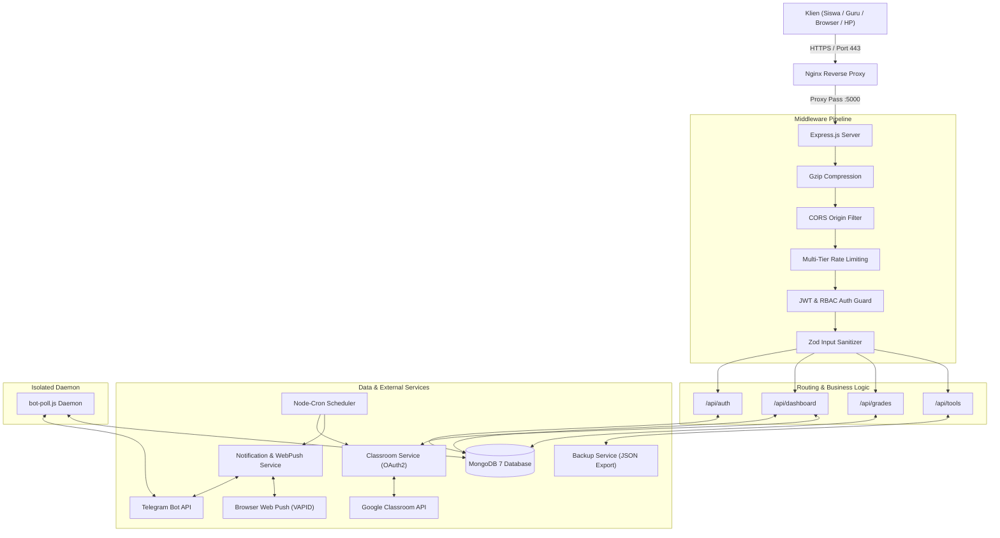

# DOKUMENTASI LENGKAP ARSITEKTUR & PENJELASAN BACKEND
## Sistem Informasi Akademik SMK Jurusan TKJ Terintegrasi Google Classroom & Telegram

---

## 1. Gambaran Umum & Karakteristik Arsitektur

Backend project ini dirancang sebagai **Stateless RESTful API Server** berkinerja tinggi menggunakan arsitektur modular berlapis (*Layered / N-Tier Architecture*). Dibangun di atas runtime **Node.js (v20)** menggunakan framework **Express.js (v4)** dan database dokumen **MongoDB (v7)** dengan **Mongoose (v8)** sebagai *Object Data Modeling* (ODM).

### A. Karakteristik & Desain Arsitektur:
1. **Stateless Authentication (JWT)**: Server tidak menyimpan session di memori. Setiap request otentik diverifikasi secara independen melalui token kriptografi JWT (*JSON Web Token*).
2. **Pemisahan Peran (Separation of Concerns)**:
   - `config/`: Pengaturan koneksi infrastruktur basis data.
   - `models/`: Definisi skema data, validasi tingkat basis data, dan indexing.
   - `middleware/`: Filter keamanan, verifikasi token, otorisasi hak akses, dan sanitasi input.
   - `routes/`: Pengarah URL (*endpoint routing*) dan penanganan alur bisnis.
   - `services/`: Lapisan logika bisnis berat, konektor API eksternal (Google & Telegram), serta background task.
   - `utils/`: Pustaka pembantu (*helper functions*) dan sistem pencatatan log (Winston).
3. **Decoupled Background Daemon**: Proses web server HTTP (`server.js`) dan proses bot Telegram (*long-polling*) (`bot-poll.js`) dipisahkan menjadi dua proses/container mandiri. Jika terjadi gangguan jaringan pada API Telegram, web server sekolah tetap aktif 100% melayani request siswa dan guru.

---

## 2. Server Entry Point & Pipeline Middleware (`server.js`)

File `server.js` merupakan titik masuk utama (*entry point*) aplikasi. Seluruh request yang masuk dari internet melewati tahapan pipa (*middleware pipeline*) secara berurutan:

```
[Klien / Browser / HP]
         │
    (HTTPS / Port 443)
         ▼
[Cloudflare DNS + Nginx Reverse Proxy]
         │
    (HTTP Proxy ke Port 5000)
         ▼
┌─────────────────────────────────────────────────────────────┐
│                     PIPELINE SERVER.JS                      │
│                                                             │
│ 1. app.set('trust proxy', 1)                                │
│    └─ Mengenali IP asli klien di balik Cloudflare & Nginx   │
│                                                             │
│ 2. compression()                                            │
│    └─ Kompresi respon gzip otomatis (hemat bandwidth 70-85%)│
│                                                             │
│ 3. cors({ origin: [FRONTEND_URL, ...], credentials: true }) │
│    └─ Membatasi domain yang boleh mengakses API             │
│                                                             │
│ 4. express.json()                                           │
│    └─ Parsing body request bertipe JSON                     │
│                                                             │
│ 5. Multi-Tier Rate Limiting (express-rate-limit):           │
│    ├─ Global Limiter: 200 req / 15 menit (seluruh /api/)    │
│    ├─ Login Limiter: 100 req / 15 menit (mencegah brute)    │
│    └─ Forgot-Password: 5 req / 15 menit (proteksi OTP bot)  │
│                                                             │
│ 6. Request Performance Logger (Winston & Monitoring):       │
│    └─ Menghitung waktu respon (ms) & catat error status 500 │
│                                                             │
│ 7. Static Single Page Application (SPA) Serving:            │
│    └─ Menyajikan file dist React (index.html) jika ada      │
│                                                             │
│ 8. API Route Handlers (/api/*)                              │
│    └─ Mengarahkan ke masing-masing modul controller         │
└─────────────────────────────────────────────────────────────┘
```

### Penjadwal Tugas Latar Belakang (Cron Jobs Terjadwal):
Server menjalankan 4 pekerjaan otomatis terjadwal menggunakan `node-cron`:
* **`0 7 * * 1-5` (Pukul 07:00 WIB, Senin–Jumat)**: Sinkronisasi otomatis data tugas dan nilai dari Google Classroom ke database lokal.
* **`0 10 * * *` (Pukul 10:00 WIB, Setiap Hari)**: Pengiriman *Web Push Notification* ke peramban HP siswa yang memiliki tugas yang belum diserahkan.
* **`0 17 * * 1-5` (Pukul 17:00 WIB, Senin–Jumat)**: Pengiriman rekapitulasi tugas harian dan tagihan tugas melalui Bot Telegram.
* **`0 2 * * *` (Pukul 02:00 WIB, Dini Hari)**: Pencadangan otomatis (*auto-backup*) seluruh koleksi MongoDB ke file arsip JSON.

---

## 3. Sistem Keamanan, Autentikasi, dan Otorisasi (`middleware/`)

### A. Autentikasi JWT & Pengamanan Data (`middleware/auth.js`)
* **Mekanisme Token**: Token JWT dibuat saat pengguna berhasil login dengan masa berlaku 7 hari (`expiresIn: '7d'`).
* **Header Authorization**: Membaca token dari header `Authorization: Bearer <token>`.
* **Ekstraksi Efisien**: Menggunakan kueri `User.findById(decoded.userId).select('-password').lean()`. Penggunaan `.lean()` memotong pembuatan dokumen Mongoose berat, menghemat pemakaian memori server hingga 50%, serta memastikan hash password tidak pernah bocor ke objek request.

### B. Otorisasi Berbasis Peran (*Role-Based Access Control / RBAC*):
1. **`auth`**: Akses terbuka untuk semua akun yang terotentikasi (Siswa, Guru, Admin, Orang Tua).
2. **`staffOnly`**: Membatasi akses hanya untuk pengguna dengan role `admin` atau `guru` (misal: penginputan nilai dan manajemen tugas).
3. **`adminOnly`**: Membatasi akses ketat hanya untuk akun `admin` (misal: manajemen data siswa, generate kode aktivasi, backup, dan server monitoring).

### C. Validasi Input & Sanitasi (`middleware/validation.js`)
* Memanfaatkan pustaka **Zod** untuk validasi skema payload JSON sebelum menyentuh lapisan database.
* Memastikan format NIS/NISN sesuai pola numerik sekolah, panjang password memenuhi standar keamanan, dan mencegah injeksi data.
* Enkripsi kata sandi menggunakan pustaka **`bcryptjs`** dengan nilai *salt rounds* 10 sebelum disimpan ke database.

---

## 4. Lapisan Basis Data & Model Skema (`models/`)

Sistem menggunakan 8 koleksi utama di dalam database `smk_akademik`:

| No | Model | File | Deskripsi & Fields Kunci |
|:---|:---|:---|:---|
| 1 | **User** | `models/User.js` | Data kredensial login: `nisn`/`nis`, `password` (hash bcrypt), `role` (`admin`, `guru`, `student`, `parent`), token OAuth Google (`googleAccessToken`, `googleRefreshToken`, `googleConnected`), status aktif, dan timestamp `lastLogin`. |
| 2 | **Student** | `models/Student.js` | Dokumen induk siswa: `nis`, `nama`, `kelas` (X/XI/XII), `rombel` (TKJ 1/TKJ 2), `angkatan`, `classroomId` (ID siswa di sistem Google Classroom). Dilengkapi *compound index* untuk mempercepat pencarian per kelas. |
| 3 | **Grade** | `models/Grade.js` | Nilai manual yang diinput guru: `studentId`, `subject` (ASJ, AIJ, TJBL, PKDK, TJKT), `type` (UTS, UAS, Tugas, Praktik), `score` (0–100), `semester`, dan ID guru penginput (`inputBy`). |
| 4 | **CourseworkCache** | `models/CourseworkCache.js` | Caching data Google Classroom: `courseId`, `courseWorkId`, `title`, `dueDate`, `maxPoints`, array `studentSubmissions` (status tugas, keterlambatan, nilai tugas). |
| 5 | **ChatId** | `models/ChatId.js` | Menghubungkan NIS/studentId siswa dengan `chatId` Telegram mereka untuk rute pengiriman notifikasi pribadi. |
| 6 | **ActivationCode** | `models/ActivationCode.js` | Kode aktivasi unik acak (`crypto.randomBytes(3).toString('hex')`) untuk proses pairing akun Telegram siswa ke sistem. |
| 7 | **PushSubscription** | `models/PushSubscription.js` | Menyimpan endpoint langganan browser dan kunci kriptografi VAPID untuk Web Push Notification ke HP siswa. |
| 8 | **AdminMessage** | `models/AdminMessage.js` | Pesan pengumuman sekolah dengan target spesifik (`targetKelas`, `targetAngkatan`, atau `isGlobal`) serta tanggal kedaluwarsa (`expiresAt`). |

---

## 5. Rincian Router & Logika Bisnis (`routes/`)

### 1. `routes/auth.js` (Otentikasi & Keamanan Akun)
* **`POST /api/auth/login`**: Memvalidasi kredensial pengguna, mencocokkan hash password dengan `bcrypt.compare()`, mencatat `lastLogin`, dan mengembalikan token JWT serta payload identitas pengguna.
* **`POST /api/auth/forgot-password`**: Menerima NIS siswa yang lupa password. Sistem secara otomatis mencari `chatId` Telegram siswa terkait, membuat kode OTP 6 digit berbatas waktu 10 menit, dan mengirimkan OTP tersebut ke Telegram siswa.
* **`POST /api/auth/verify-otp` & `reset-password`**: Memvalidasi kesesuaian OTP lalu melakukan hashing password baru sebelum disimpan ke basis data.
* **`GET /api/auth/google` & `/google/callback`**: Menjalankan siklus OAuth2 persetujuan izin Google Classroom API untuk akun Admin/Guru.

### 2. `routes/dashboard.js` (Agregasi Data & Algoritma Peringkat)
Merupakan router dengan komputasi paling intensif:
* **Penggabungan Data Nilai Multi-Sumber**: Menggabungkan data dari `CourseworkCache` (Google Classroom) dan `Grade` (Manual guru) untuk 5 mata pelajaran produktif TKJ (ASJ, AIJ, TJBL, PKDK, TJKT).
* **Algoritma Ranking O(N + M)**: Menghitung rata-rata nilai seluruh siswa sekelas dan seangkatan secara dinamis menggunakan struktur data `Map`, sehingga penentuan peringkat ratusan siswa selesai dalam hitungan beberapa milidetik tanpa membebani CPU server.
* **Penyaringan Pesan Admin**: Menyaring pesan yang masih berlaku (*not expired*) dan ditujukan sesuai rombel siswa.

### 3. `routes/grades.js` & `routes/classroomGrades.js`
* Mendukung operasi *bulk write* (`bulkWrite()`) MongoDB, memungkinkan guru menyimpan atau memperbarui puluhan nilai siswa sekaligus dalam 1 kali transaksi HTTP.
* Endpoint ekspor data rekap nilai ke format berkas Excel yang diformat secara terprogram (judul tabel, warna header, perataan, dan rumus rata-rata).

### 4. `routes/admin.js`, `routes/tools.js`, & `routes/analytics.js`
* **Manajemen Siswa**: CRUD data siswa dan import massal dari format file CSV / Excel.
* **Tagihan Tugas (`/missing-tasks`)**: Mendeteksi tugas yang belum diserahkan oleh siswa menjelang tenggat waktu.
* **Pemantauan Server (`/api/tools/monitoring`)**: Menampilkan metrik Uptime, sisa RAM, beban CPU, dan log error sistem secara langsung.

---

## 6. Layanan Eksternal & Background Workers (`services/` & `bot-poll.js`)

### A. Layanan Google Classroom (`services/classroom.js`)
Layanan ini mengimplementasikan teknik rekayasa khusus guna mengantisipasi pembatasan kuota (*rate limit*) Google:
1. **Parallel Concurrency Control (`mapWithConcurrency`)**: Request dibatasi maksimal 4 kelas secara paralel (`COURSE_CONCURRENCY = 4`) dan 6 tugas secara paralel (`WORK_CONCURRENCY = 6`).
2. **Exponential Backoff Retry (`apiWithRetry`)**: Jika Google mengembalikan HTTP status 429 (*Rate Limit Exceeded*), sistem otomatis menunggu secara bertahap (400ms, 800ms, 1200ms) dan mencoba ulang hingga 3 kali.
3. **Selective Field Masking**: Hanya meminta field data yang dibutuhkan (`courseWork(id,title,dueDate,maxPoints)` dan `studentSubmissions(userId,state,late,grade)`), menghemat lalu lintas transfer data hingga 60%.
4. **Cache Freshness TTL**: Data tugas yang sudah ada di cache lokal hanya akan disinkronkan ulang jika usianya sudah melampaui 5 menit (`SUBMISSION_FRESH_MS = 5 * 60 * 1000`).

### B. Telegram Bot Polling Runner (`bot-poll.js`)
* Berjalan sebagai proses daemon mandiri menggunakan teknik *long-polling* (`getUpdates`).
* Menangani command interaktif pengguna:
  * `/start`: Menyapa siswa dan menampilkan panduan penggunaan.
  * `/help`: Menampilkan daftar perintah yang tersedia.
  * `/aktivasi <code>`: Memverifikasi token aktivasi, lalu menyimpan ID Telegram siswa ke koleksi `ChatId`.
  * `/nilai`: Menampilkan rekapitulasi nilai per mata pelajaran dan daftar tugas yang belum diselesaikan secara langsung di ruang obrolan Telegram.

### C. Sistem Pencadangan Otomatis (`services/backup.js`)
* Mengekspor seluruh isi database (User, Student, Grade, CourseworkCache, ChatId, ActivationCode, AdminMessage) ke format berkas JSON terarsip.
* Dilengkapi algoritma retensi berkas: secara otomatis memindai dan menghapus file cadangan yang usianya sudah melewati 30 hari untuk menjaga efisiensi ruang penyimpanan hard disk.

### D. Sistem Pemantauan Server (`services/monitoring.js`)
* Merekam metrik kesehatan server secara in-memory: waktu aktif (*uptime*), pemakaian RAM terhadap kapasitas total, beban kerja CPU, status koneksi MongoDB, serta mencatat 50 error terakhir yang terjadi untuk kebutuhan debugging.

---

## 7. Diagram Alur Kerja Backend (Workflow Diagram)



---
*Dokumen arsitektur backend ini disusun untuk keperluan dokumentasi teknis, pengujian sistem, dan laporan akhir Praktik Kerja Lapangan (PKL).*
